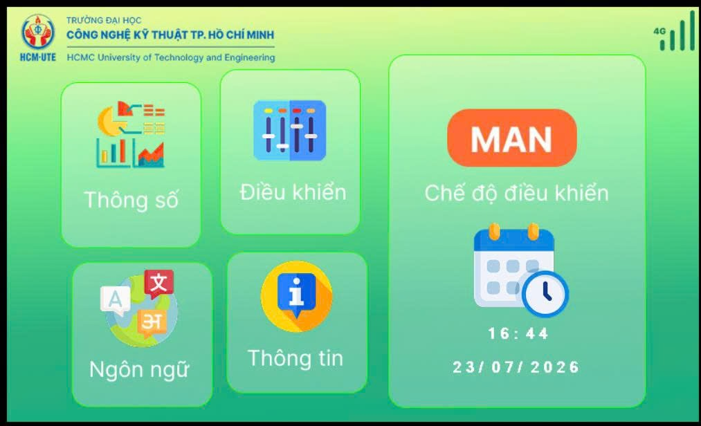
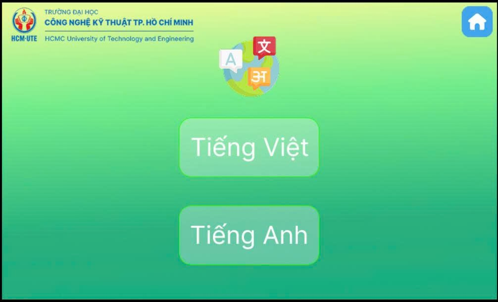
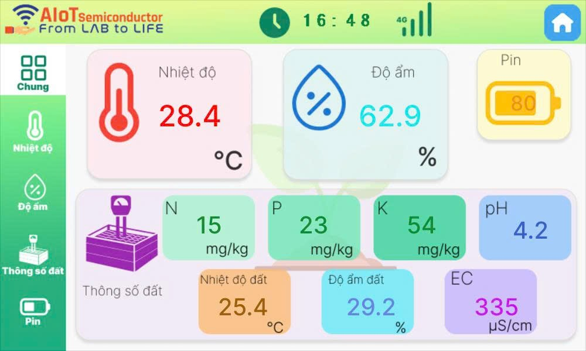
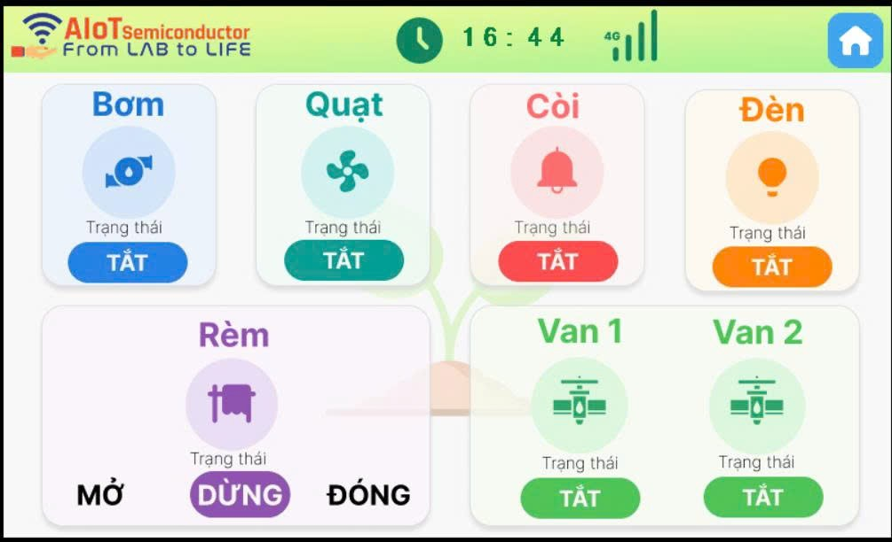

# DWIN HMI for Smart Greenhouse Monitoring and Control

[](https://www.dwin-global.com/)
[]()
[]()
[](https://www.figma.com/)
[]()

---

## Table of Contents

1. [Overview](#overview)
2. [Design Requirements](#design-requirements)
3. [Hardware Design](#hardware-design)
   - [System Architecture](#system-architecture)
   - [UI Design and Screenshots](#ui-design-and-screenshots)
   - [VP Address Map](#vp-address-map)
   - [Serial Protocol](#serial-protocol)
   - [Language, Mode and Password Control](#language-mode-and-password-control)
4. [Repository Structure](#repository-structure)
5. [Getting Started](#getting-started)
6. [References and Credits](#references-and-credits)
7. [Author](#author)

---

## Overview

Greenhouse farming depends on keeping air and soil conditions within a narrow range and reacting quickly when they drift. This project is a **7-inch touchscreen HMI** built on a **DWIN DMG80480C070** display. It gives the operator a local panel to monitor the environment and run the equipment without a phone or a laptop.

The screen does not read sensors itself. It talks to a host MCU over UART using **VP (Variable Pointer) addresses**, so it can be reused with any controller that follows the address map in this repository.

Main functions:

- **Monitor** battery level, air temperature and humidity (min, max, average), and seven soil parameters: temperature, moisture, N, P, K, EC and pH.
- **Track trends** on eight real-time curves.
- **Control** the pump, two valves, light, buzzer, fan and curtain.
- **Switch AUTO / MAN** mode. In AUTO the MCU runs the outputs and the control screen is locked.
- **Work in two languages** (Vietnamese and English) with a real-time clock (hour, minute, day, month, year).

---

## Design Requirements

The requirements were defined first, then used to build the pages and the VP map.

### Summary

| Item | Target |
| --- | --- |
| Display | DWIN DMG80480C070, 7", 800 × 480 |
| Interface | UART to host MCU, DWIN T5L protocol |
| Languages | Vietnamese, English |
| Operating modes | MAN, AUTO (screen locked in AUTO) |
| UI design tool | Figma |
| Configuration tool | DWIN DGUS II tool (`DWprj.hmi`) |

### Functional requirements

**Monitoring**
- Battery level and 4G signal icon
- Air temperature and humidity, each with min, max and average
- Soil temperature, moisture, N, P, K, EC and pH
- Date and time (hour, minute, day, month, year)

**Charts**
- Eight curve channels: air temperature, air humidity, soil temperature, soil moisture, battery, pH, EC, N

**Control**
- Pump, valve 1, valve 2, light, buzzer, fan
- Curtain with three states: stop, close, open

**System**
- Vietnamese and English page sets with identical layout
- AUTO / MAN selection, with the control screen locked in AUTO
- Password keypad (change password, confirm, notifications)

---

## Hardware Design

### System Architecture


| Item | Detail |
| --- | --- |
| Display | DWIN DMG80480C070 (7", 800 × 480) |
| UI design | Figma, exported as images |
| Configuration | DWIN DGUS II tool, opens `DWprj.hmi` |
| Config file | `DWIN_SET/T5LCFG` (UART, RTC, touch and other settings) |
| Host | MCU connected over UART |

### UI Design and Screenshots

Every page is drawn in Figma at 800 × 480. One set is made for Vietnamese and one for English with identical layouts, exported to `53Viet` and `32Anh`, then imported as page backgrounds in `DWprj.hmi`. Data variables, text, curves, touch keys and icons are placed on top and linked to VP addresses.

| Screen 1 – Home | Screen 2 – Language |
| :---: | :---: |
|  |  |
| **Screen 3 – Data** | **Screen 4 – Control** |
|  |  |


**Page map**

| Page ID | Page |
| --- | --- |
| `0x0077` (119) | Control page, Vietnamese |
| `0x0083` (131) | Control page, English |


### VP Address Map

All addresses are **hexadecimal**. `ON = 0x0001`, `OFF = 0x0000`.

**Control**

| Function | VP | Values |
| --- | --- | --- |
| Pump | `5060` | 0001 on / 0000 off |
| Fan | `5061` | 0001 on / 0000 off |
| Buzzer | `5062` | 0001 on / 0000 off |
| Light | `5063` | 0001 on / 0000 off |
| Valve 1 | `5064` | 0001 on / 0000 off |
| Valve 2 | `5065` | 0001 on / 0000 off |
| Curtain | `5066` | 0001 stop / 0002 close / 0003 open |
| AUTO / MAN | `7200` | 0000 MAN / 0001 AUTO |

**Sensor data**

| Parameter | VP | Parameter | VP |
| --- | --- | --- | --- |
| Air temperature | `5150` | Soil temperature | `5216` |
| Air temp. min | `5154` | Soil moisture | `5224` |
| Air temp. max | `5158` | N | `5228` |
| Air temp. average | `5162` | P | `5232` |
| Air humidity | `5166` | K | `5236` |
| Air humidity min | `5170` | EC | `5240` |
| Air humidity max | `5174` | pH | `5244` |
| Air humidity average | `5178` | Soil moisture average | `5248` |
| Battery | `5182` | | |

Addresses are spaced by 4. One text length unit holds 2 characters.

**Status, time and scrolling text**

| Function | VP |
| --- | --- |
| Time and date setting | `5040` |
| Battery icon | `7300` |
| 4G icon | `7400` |
| Scrolling text | `5000`, `7800`, `7900` |

The time-setting field combines a basic touch module with a variable icon, a variable icon with icon page transition and sliding icon selection, and a return key code at `1000`.

**Curve channels**

| Channel | Data | Clear command |
| --- | --- | --- |
| 0 | Air temperature | `5A A5 05 82 03 01 00 00` |
| 1 | Air humidity | `5A A5 05 82 03 03 00 00` |
| 2 | Soil temperature | `5A A5 05 82 03 05 00 00` |
| 3 | Soil moisture | `5A A5 05 82 03 07 00 00` |
| 4 | Battery | `5A A5 05 82 03 09 00 00` |
| 5 | pH | `5A A5 05 82 03 0B 00 00` |
| 6 | EC | `5A A5 05 82 03 0D 00 00` |
| 7 | N | `5A A5 05 82 03 0F 00 00` |

Curve axis labels use text variables spaced by `0x10`:

| Chart | VP range |
| --- | --- |
| Air temperature | `7500`, `7510`, `7520` … `7590` |
| Air humidity | `75A0`, `75B0`, `75C0` … `7630` |
| Soil temperature, moisture, pH, EC, N | `7640`, `7650`, `7660` … `76D0` |
| Battery | `76E0`, `76F0`, `7700` … `7770` |

Curve controls start from `0x5000`.

### Serial Protocol

Every frame starts with the header `5A A5`, followed by the length, the command and the data. `<len>` counts every byte after it.

| Command | Code | Frame format |
| --- | --- | --- |
| Write VP | `82` | `5A A5 <len> 82 <VP hi> <VP lo> <data...>` |
| Read VP | `83` | `5A A5 <len> 83 <VP hi> <VP lo> <word count>` |

| Action | Frame |
| --- | --- |
| Fan off (VP `5061`) | `5A A5 05 82 50 61 00 00` |
| Fan on (VP `5061`) | `5A A5 05 82 50 61 00 01` |
| Ask current page | `5A A5 04 83 00 14 01` |
| Current page reply | `5A A5 06 83 00 14 01 <page ID>` |

The return key code only reports touch events when **Data auto-uploading** is enabled. Turn it on for every control that the MCU must receive.

### Language, Mode and Password Control

**Language switching.** Each language has its own page set. A page jump is a write to register `0x0084`:

| Target | Frame |
| --- | --- |
| Vietnamese control page (`0x0077`) | `5A A5 07 82 00 84 5A 01 00 77` |
| English control page (`0x0083`) | `5A A5 07 82 00 84 5A 01 00 83` |

The MCU should ask the current page to know which language is active, use the same VP addresses on both sets, and re-send the current values after every switch.

**AUTO / MAN and screen lock.**

| Mode | VP `7200` | Behavior |
| --- | --- | --- |
| MAN | `0000` | All control keys are active. |
| AUTO | `0001` | The MCU controls the outputs. The control screen is locked. |

In AUTO, a transparent lock layer (variable icon driven by VP `7200`) covers the control area, and the MCU ignores key codes for `5060`–`5066` and writes the real output state back so the display never shows a stale state.


**Password keypad.** Key codes: `0`–`9` = `30`–`39`, Delete = `40`, OK = `41`.

| Field | Vietnamese VP | English VP |
| --- | --- | --- |
| Old password | `6000` | `6600` |
| New password | `6100` | `6700` |
| Confirm | `6200` | `6800` |
| Password notice (change) | `6300` | `6900` |
| Enter password | `6400` | `7000` |
| Password notice (enter) | `6500` | `7100` |

---

## Repository Structure

```
HMI/
├── 32Anh/                  # Page images, English
├── 53Viet/                 # Page images, Vietnamese
├── ICON/                   # Icon library
├── image/                  # Source images exported from Figma
├── TFT/                    # TFT resources
├── DWIN_SET/               # Auto-generated by the tool, copy to SD card
│   └── T5LCFG              # Display configuration (editable)
├── DWprj.hmi               # Project file, open in the DWIN tool
├── DWprj.tft               # Compiled project
├── 0_VPcode.txt            # VP address list used by the MCU firmware
└── README.md
```

---

## Getting Started

1. Install the DWIN DGUS II tool and open `DWprj.hmi` to check the pages and VP addresses.
2. Generate the project. The tool creates the `DWIN_SET` folder.
3. Edit `DWIN_SET/T5LCFG` if you need to change the UART baud rate, RTC or touch settings.
4. Copy `DWIN_SET` to the root of a FAT32 SD card.
5. Power off the display, insert the card and power on. Wait for the download to finish, then remove the card and restart.
6. Connect the display UART to the host MCU and send frames as described in [Serial Protocol](#serial-protocol).


**Notes and pitfalls**

- Keep track of **HEX vs DEC**. All VP addresses and data here are hexadecimal.
- When you **copy a control**, check its **initial value**. It often defaults to `0` or to the Vietnamese text.
- **Return Key Code** needs **Data auto-uploading**, or the MCU receives nothing.
- **One text length unit holds 2 characters.**
- The incremental adjustment control lets you choose continuous press or one step per press.
- Use the same VP on the Vietnamese and English pages. Only the page and the images differ.

---

## References and Credits

- DWIN. *T5L DGUS II Application Development Guide*, V2.921. Protocol, VP and control reference used for this project.
- DWIN. DMG80480C070 display, https://www.dwin-global.com/
- Figma, https://www.figma.com/ (UI design)

The page design, VP address map and MCU frames in this repository were created for this project.

---

## Author

- **Huynh Vo Phuc Loc**
- GitHub: [Dong-quan](https://github.com/Dong-quan)
